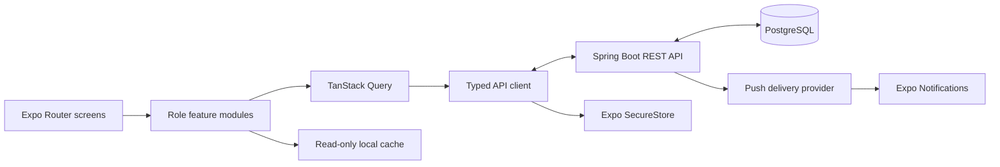

# Stanfordos Mobile Architecture

## Purpose and boundaries
Stanfordos Mobile is the Android/iOS client for the existing Stanford SMS/LMS platform.
- Client: React Native, Expo, TypeScript and Expo Router.
- Backend: existing Spring Boot REST API in [MAROOTS/stanford-sms-lms](https://github.com/MAROOTS/stanford-sms-lms).
- Database: existing PostgreSQL database. The mobile app never connects directly to it.
- This is a separate sibling repository.

The backend roles are exactly `ADMIN`, `TEACHER`, `STUDENT`, `PARENT`, `LIBRARIAN`, `ACCOUNTANT`, and `PLATFORM_ADMIN`. Do not invent a `STAFF` role.

## System architecture


## Recommended source layout
```text
app/
  _layout.tsx
  (auth)/
  (app)/
src/
  api/                 # typed HTTP client, DTOs, endpoint modules
  auth/                # session, tenant context, role guards
  components/          # shared UI
  features/
    admin/
    teacher/
    student/
    parent/
    librarian/
    accountant/
    platform-admin/
  hooks/
  offline/              # read-only cache and connectivity
  notifications/
  theme/
  types/
  utils/
assets/
docs/
```

This is a target structure; it does not imply these application files have already been scaffolded.

## Technology choices
| Concern | Choice |
|---|---|
| Native app | Expo / React Native |
| Language | TypeScript, strict mode |
| Navigation | Expo Router |
| Server state | TanStack Query |
| HTTP | Axios behind a typed API wrapper |
| Forms | React Hook Form + Zod |
| Secure credentials | expo-secure-store |
| Push | expo-notifications + expo-device |
| Icons | lucide-react-native |
| Tests | Jest/Vitest-compatible setup + React Native Testing Library |

Use versions compatible with the selected Expo SDK. Prefer `npx expo install` for Expo-managed native packages.

## Layering and ownership
1. Screens render UI and collect input.
2. Feature hooks/services implement use cases.
3. API modules own routes, DTOs, error normalization and multipart behavior.
4. Auth owns tenant context and token lifecycle.
5. Query/local cache owns previously fetched read models.
6. Native adapters wrap SecureStore, notifications and connectivity.

Do not call Axios directly from screens. Backend authorization is authoritative; client-side route guards are only a usability layer.

## Role-aware navigation
- ADMIN: school administration and academic operations.
- TEACHER: assigned classes, attendance, marks, courses and assignments.
- STUDENT: own learning, results where permitted, assignments and submissions.
- PARENT: linked children, permitted attendance and fee information. Parent results remain gated until backend access exists.
- LIBRARIAN: library workflows after library API audit.
- ACCOUNTANT: invoices, fee payments and receipts.
- PLATFORM_ADMIN: platform-level features only where explicit backend endpoints exist.

A role label does not prove an API exists. Tie each screen to an audited capability.

## State management
- TanStack Query: remote server state.
- React state: transient UI state.
- SecureStore: tokens and minimum session metadata.
- Local cache: explicitly approved read-only data.
- Clear query and persisted user data on logout, account switch, tenant switch or session invalidation.
- Never persist passwords or raw authorization headers.

## Environment and connectivity
```dotenv
EXPO_PUBLIC_API_URL=https://your-staging-api.example.com
EXPO_PUBLIC_APP_ENV=development
```
A physical phone cannot reach the developer machine via `localhost`; use the machine's LAN IP or a secure tunnel. Use HTTPS for staging and production. Never place secrets in `EXPO_PUBLIC_*`.

## UX principles
Provide consistent loading, empty, error, validation, offline and stale-data states. Design for low bandwidth, accessible touch targets and platform conventions. Offline reads are permitted; offline mutations are not.
